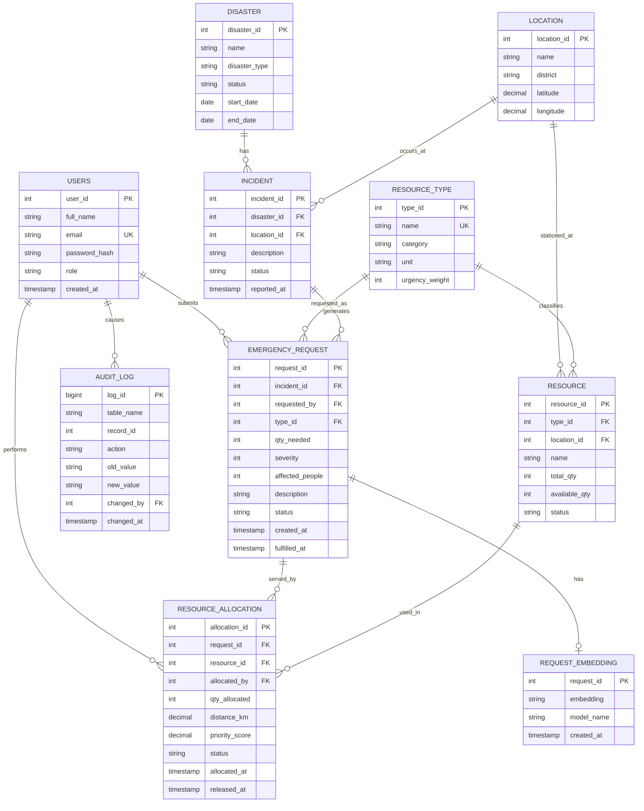

# ER Diagram

## Key design points

- **EMERGENCY_REQUEST and RESOURCE are M:N**, resolved by RESOURCE_ALLOCATION, which carries its own attributes (quantity, distance, score, status, timestamps).
- **Priority score** (severity, affected people, resource urgency weight, waiting time) belongs to the request. **Match score** (distance, availability) belongs to a request-resource pair, so distance lives on the allocation.
- **REQUEST_EMBEDDING** is a 1:1 optional child of the request (its `request_id` is both PK and FK), with `ON DELETE CASCADE`. The `embedding` column is a pgvector `vector(384)`, shown as text here because Mermaid has no vector type.
- **AUDIT_LOG** deliberately has no FK to the audited tables, so history survives deletions. `old_value` and `new_value` are JSONB in the real schema.